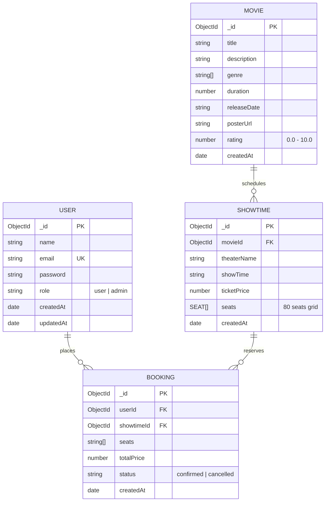

# 🎬 iMovies - Movie Ticket Booking Made Simple (MERN Stack)

> A modern cinema ticket booking web platform built with a high-performance Express.js backend, MongoDB persistence, and a sleek React Single Page Application (SPA). Seamlessly handles real-time seat availability, multi-tier 8x10 theater grids, transient seat locking, digital ticket passes, and exhibitor administration.

---

## 📑 Table of Contents

1. [Key Features](#-key-features)
2. [Technical Architecture](#-technical-architecture)
3. [MVC Architectural Breakdown](#-mvc-architectural-breakdown)
4. [Mermaid.js Entity-Relationship (ER) Diagram](#-mermaidjs-entity-relationship-er-diagram)
5. [API Endpoints Reference](#-api-endpoints-reference)
6. [Directory Structure](#-directory-structure)
7. [Getting Started & Local Run Instructions](#-getting-started--local-run-instructions)
8. [Demo Credentials](#-demo-credentials)

---

## 🌟 Key Features

- **Trending Movie Catalog**: Real-time category/genre filtering (Sci-Fi, Action, Animation, Drama, etc.), instant search, ratings, runtimes, and synopses.
- **Hindi & Hollywood Collection**: Top Bollywood blockbusters (*Baahubali 2: The Conclusion*, *Stree 2*, *Jawan*, *12th Fail*, *Fighter*, *Animal*) alongside Hollywood hits (*Oppenheimer*, *Interstellar*, *The Batman*, *Inception*).
- **Showtime & Theater Selector**: Browse upcoming screenings across various theaters (IMAX, Dolby Atmos, VIP lounges) with real-time ticket pricing.
- **Interactive 8x10 Theater Grid**: 80-seat auditorium matrix (Rows A-H, Cols 1-10) with tiered pricing:
  - **VIP Recliner** (Rows A-B)
  - **Prime Gold** (Rows C-E)
  - **Classic Silver** (Rows F-H)
- **10-Minute Transient Seat Hold**: Prevents concurrent double-booking with atomic check and live countdown timer.
- **Digital Cinema Ticket Pass**: Instant confirmation with unique reference ID (`IMV-XXXXX`), date, time, and print-ready stub.
- **Role-Based Access Control (RBAC)**: Dedicated Exhibitor Admin dashboard to publish new films and manage theater catalogs.

---

## 🏗️ Technical Architecture

```
+-------------------------------------------------------+
|                 Client (React+Vite)                   |
| - React Router DOM v6                                 |
| - Bootstrap 5 + Cinema Dark Mode                      |
| - Axios Auth Interceptor                              |
+-------------------------------------------------------+
                           |
                           | HTTP / JSON
                           | Authorization: Bearer <JWT>
                           v
+-------------------------------------------------------+
|                 Node.js / Express API                 |
| - CORS, Body Parsers                                  |
| - verifyToken & isAdmin                               |
+-------------------------------------------------------+
       |                      |                      |
       v                      v                      v
+--------------+      +---------------+      +--------------------+
| Auth Contrl. |      | Movie/Show    |      | Booking Controller |
| Reg. / Login |      | Controllers   |      | Atomic Lock & Check|
+--------------+      +---------------+      +--------------------+
       \                      |                      /
        \                     |                     /
         v                    v                    v
          [             Mongoose ODM             ]
```

---

## 🏛️ MVC Architectural Breakdown

The project follows clean Separation of Concerns adhering strictly to the **Model-View-Controller (MVC)** design pattern:

### 1. Model Layer (`server/models/`)
- Encapsulates domain logic, data schemas, default values, and database integrity constraints.
- `User.js`: Enforces unique emails, password hashing via pre-save hooks, and password comparison methods.
- `Movie.js`: Stores title, rich descriptions, genres, duration, release dates, poster URLs, and ratings.
- `Showtime.js`: References the target `Movie`, records theater venue, show date/time, ticket price, and holds an embedded subdocument array of 80 seats.
- `Booking.js`: Stores confirmed reservations, links `userId` and `showtimeId`, records seat codes, total price, and lifecycle status (`confirmed | cancelled`).

### 2. View Layer (`client/`)
- Modern Single-Page Application (SPA) driven by **React 18** and **Vite**.
- Component-driven UI using **Bootstrap 5** with custom dark cinema glassmorphism styles.
- State-driven reactivity with **React Context API** (`AuthContext`) for universal authentication state and token persistence.
- Client-side routing with **React Router DOM v6**.

### 3. Controller Layer (`server/controllers/`)
- `authController.js`: Manages user registration, JWT generation, and credentials validation.
- `movieController.js`: Handles catalog CRUD operations, genre filters, and search indexing.
- `showtimeController.js`: Manages screening slots, formats, and generates 80-seat matrix instances.
- `bookingController.js`: Executes atomic seat lock verification, processes reservations, and handles cancellations.

---

## 📊 Mermaid.js Entity-Relationship (ER) Diagram



---

## 📡 API Endpoints Reference

### Authentication (`/api/auth`)
| Method | Endpoint | Description | Access |
| :--- | :--- | :--- | :--- |
| `POST` | `/api/auth/register` | Register a new user account | Public |
| `POST` | `/api/auth/login` | Authenticate user & return signed JWT | Public |
| `GET` | `/api/auth/me` | Retrieve active authenticated profile | Bearer JWT |

### Movies (`/api/movies`)
| Method | Endpoint | Description | Access |
| :--- | :--- | :--- | :--- |
| `GET` | `/api/movies` | Fetch movies with optional `?genre=&search=&language=` | Public |
| `GET` | `/api/movies/:id` | Fetch specific movie details and trailer embed | Public |
| `POST` | `/api/movies` | Publish a new movie to catalog | Admin (Bearer JWT) |
| `DELETE` | `/api/movies/:id` | Remove a movie from listings | Admin (Bearer JWT) |

### Showtimes (`/api/showtimes`)
| Method | Endpoint | Description | Access |
| :--- | :--- | :--- | :--- |
| `GET` | `/api/showtimes/movie/:movieId` | Fetch scheduled screenings for a movie | Public |
| `GET` | `/api/showtimes/:id` | Retrieve 80-seat grid availability map | Public |
| `POST` | `/api/showtimes` | Schedule a new screening with 80-seat matrix | Admin (Bearer JWT) |

### Bookings (`/api/bookings`)
| Method | Endpoint | Description | Access |
| :--- | :--- | :--- | :--- |
| `POST` | `/api/bookings/lock` | Acquire transient 10-minute hold on selected seats | Public |
| `POST` | `/api/bookings` | Finalize ticket reservation with atomic check | Bearer JWT |
| `GET` | `/api/bookings/user/:userId` | Retrieve user bookings and ticket passes | Bearer JWT |
| `PUT` | `/api/bookings/cancel/:id` | Cancel reservation and restore seat availability | Bearer JWT |

---

## 📁 Directory Structure

```
imovies-mern/
├── client/                      # React + Vite Frontend
│   ├── public/
│   │   └── vite.svg
│   ├── src/
│   │   ├── api/
│   │   │   └── axios.js         # Axios instance with baseURL & JWT interceptor
│   │   ├── components/
│   │   │   ├── AuthModal.jsx    # Tabbed Sign In / Register modal with quick-fill
│   │   │   ├── BookingModal.jsx # Booking confirmation & price summary modal
│   │   │   └── Navbar.jsx       # Global responsive navigation header
│   │   ├── context/
│   │   │   └── AuthContext.jsx  # Context provider for user auth state
│   │   ├── pages/
│   │   │   ├── AdminAddMovie.jsx# Admin dashboard to publish new movies
│   │   │   ├── Home.jsx         # Movie catalog, genre filtering & search
│   │   │   ├── MovieDetails.jsx # Movie synopsis & showtime selector
│   │   │   ├── MyBookings.jsx   # User confirmed bookings & cancellation
│   │   │   └── SeatMatrix.jsx   # Interactive 8x10 theater grid with screen glow
│   │   ├── App.jsx              # Application router & layout
│   │   ├── index.css            # Custom cinema dark-mode styling
│   │   └── main.jsx             # React entry point
│   ├── index.html
│   ├── package.json
│   └── vite.config.js
└── server/                      # Node.js + Express + MongoDB Backend
    ├── config/
    │   └── db.js                # MongoDB connection handler
    ├── controllers/
    │   ├── authController.js    # Register, login, jwt generation
    │   ├── movieController.js   # CRUD movies
    │   ├── showtimeController.js# Showtimes query & seat availability
    │   └── bookingController.js # Seat booking, cancellation & atomic lock
    ├── middleware/
    │   └── auth.js              # verifyToken and isAdmin middleware
    ├── models/
    │   ├── User.js
    │   ├── Movie.js
    │   ├── Showtime.js
    │   └── Booking.js
    ├── routes/
    │   ├── authRoutes.js
    │   ├── movieRoutes.js
    │   ├── showtimeRoutes.js
    │   └── bookingRoutes.js
    ├── seed/
    │   └── seed.js              # Database seed script
    ├── .env.example
    ├── package.json
    └── server.js                # Express app entrypoint
```

---

## 🚀 Getting Started & Local Run Instructions

### 1. Prerequisites
- **Node.js**: `v18.x` or higher
- **MongoDB**: Local Community Server (`mongodb://127.0.0.1:27017/imovies`) or MongoDB Atlas cluster URI (optional, automatic high-speed fallback enabled)

### 2. Backend Setup
```bash
cd server
npm install
npm run seed     # Pre-populates Baahubali 2, Hindi movies & showtimes
npm start        # Starts server on http://localhost:5000
```

### 3. Frontend Setup
```bash
cd ../client
npm install
npm run dev      # Starts React Vite client on http://localhost:5173
```

---

## 🔐 Demo Credentials

Quick-fill demo logins are available directly inside the **Sign In** modal:

| Role | Name | Email | Password |
| :--- | :--- | :--- | :--- |
| **User** | Aaradhya Sharma | `aaradhya.sharma@imovies.com` | `user123` |
| **Exhibitor Admin** | IMovies Admin | `admin@imovies.com` | `admin123` |
